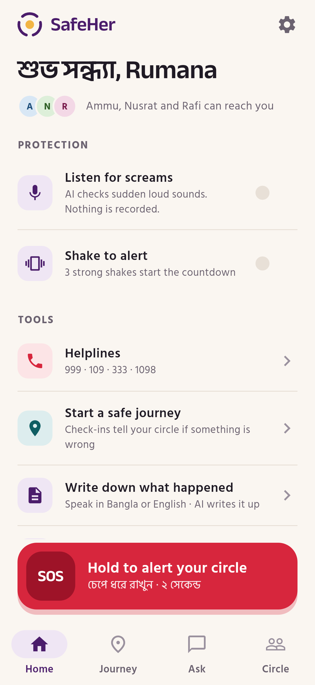
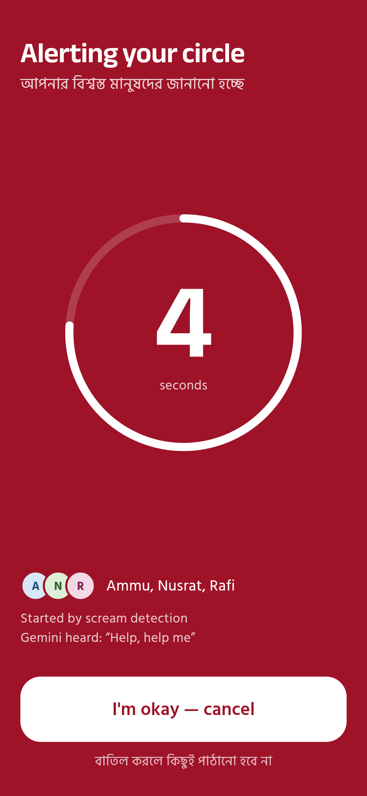
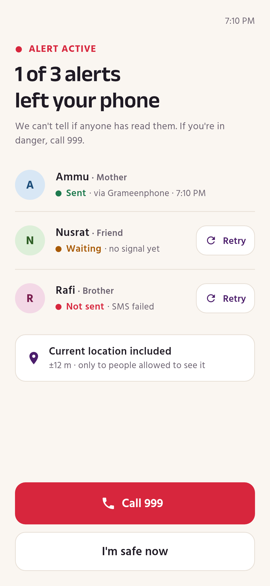
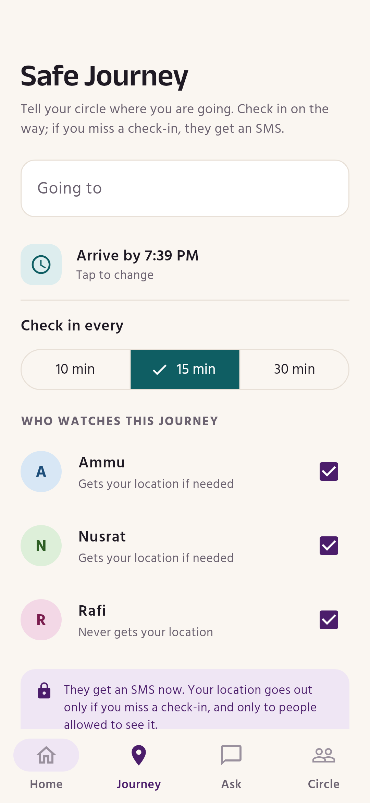
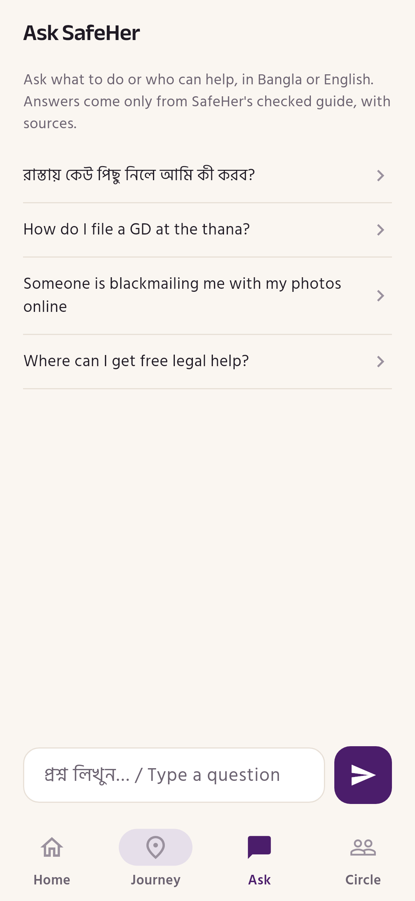
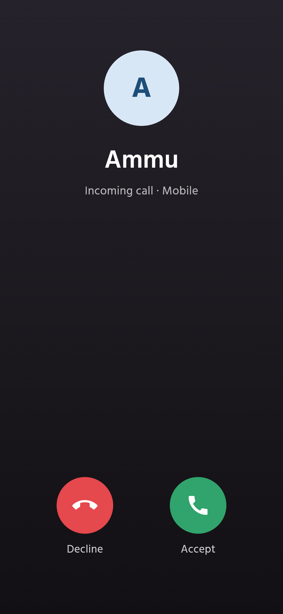

<p align="center">
  
</p>

<h1 align="center">SafeHer</h1>

<p align="center">
  A Bangla-first women's safety app for Android.<br>
  Alert your trusted circle by SMS, check in on journeys, and get honest, sourced help with AI.
</p>

<p align="center">
  <b>Team Space Jelly</b> · International AI Builders Congress 2026 · Idea to Unicorn
</p>

<p align="center">
  <a href="https://github.com/mdtanzimulislamrefat/SafeHer/releases/latest">Download the APK</a>
</p>

---

<p align="center">
  
  
  
  
</p>

## Why

A 2024 national survey by BBS and UNFPA, as reported by The Daily Star, found that about 76% of women in Bangladesh have faced violence and 51.5% do not know where to report it; only about 12% knew of the 109 helpline. In a frightening moment there is rarely time to unlock a phone, find numbers and type. Many safety apps need internet, an account, or a contact who installed the same app, and many promise "help is on the way" when they cannot know that.

SafeHer is built to be fast, private and honest.

## What it does

| Feature | How it works |
|---|---|
| **SOS** | Hold the red bar for 2 s (a tap does nothing). A 5-second countdown lets you cancel. Your circle gets an SMS from your own SIM with your location, so they need no app and no internet. If the default SIM has no network, SafeHer tries the other SIM. Each person shows **Sent / Waiting / Not sent** with Retry, never a false "delivered". |
| **Shake to alert** | Three hard shakes within 2 s start the countdown. Walking and single bumps don't count. Low / Medium / High sensitivity. |
| **AI scream detection** | The phone only measures loudness. A sudden loud spike sends a 2.5 s clip to Gemini, which decides whether it is distress and says what it heard ("Help, help me") on the countdown, so you can cancel a false alarm. |
| **Safe Journey** | Share your destination and arrival time, then check in every 10–30 min. A missed check-in, 6 minutes without moving, or passing your arrival time prompts you; no answer in 2 minutes texts your circle with your last location. Runs with the screen off, with an OpenStreetMap view of your path. |
| **AI incident report** | Speak or type what happened in Bangla or English. Gemini writes an editable report (when, where, who, witnesses, helplines) plus your word-for-word transcript. Saved only on your phone; you decide whether to share it. |
| **Ask SafeHer** | Ask "রাস্তায় কেউ পিছু নিলে আমি কী করব?" or "How do I file a GD?". Answers come only from a checked guide of 13 Bangladeshi help entries, with numbered sources and tap-to-call. If the guide doesn't cover it, it says so instead of guessing. |
| **Also** | Trusted Circle with per-person permissions (SOS / journeys / location), helplines (999, 109, 333, 1098), a realistic Fake Call with your own ringtone, location-sharing modes, and Delete all my data. |

<p align="center">
  
  
</p>

## How the AI is used

AI is used only where judgement on messy human input helps; everything safety-critical (SMS delivery, countdowns, timers, location) is plain, tested code.

| Where | Model | Design |
|---|---|---|
| Scream check | `gemini-flash-lite-latest`, minimal thinking | On-device loudness gate first, so audio is sent only after a spike. JSON verdict: distress, kind, confidence, what it heard. 1.9–3.2 s per clip in testing (22–33 s with default settings). |
| Incident report | `gemini-3.5-flash` → falls back to `gemini-flash-lite-latest` on rate limits | Transcript first, then every field filled only from it ("Not mentioned" instead of guesses). This stopped invented details we saw in early tests. |
| Ask SafeHer | `gemini-3.5-flash` → fallback | Grounded on [`assets/guide/help_guide.json`](assets/guide/help_guide.json): every entry has a source, link and checked date. The citation field is an enum of real entry ids, so the model cannot cite a source that doesn't exist. |

All calls use JSON response schemas. Replies are decoded as UTF-8 so Bangla is never garbled.

**Evaluation:** synthetic test clips (Pocket TTS) for the scream check, 6/6 correct; a test voice note for reports, 3/3 accurate after the transcript-first fix; 6 Ask questions in Bangla, English and Banglish, including a "danger now" case and a trap asking for a number not in the guide, all answered safely. Plus **34 automated tests** (`flutter test`).

## Privacy

- No account and no SafeHer server: contacts, settings, reports and voice notes stay on the phone.
- Location is read only for an alert or an active journey, sent only to people you allowed, and never if sharing is Off.
- Audio or notes go to Google Gemini only after you agree. On the Gemini free tier Google may use content to improve its products; the app says so before anything is sent.
- **Delete all my data** removes everything.

## Install

1. Download `SafeHer.apk` from the [latest release](https://github.com/mdtanzimulislamrefat/SafeHer/releases/latest) on an Android 7+ phone and allow "install unknown apps".
2. Add a trusted contact you control (for example your own second number).
3. Hold the SOS bar for 2 s, then cancel during the countdown to test without sending anything.
4. Shake and scream can be tested safely by tapping their rows on Home: the test sheet shows the trigger and Gemini's verdict without sending anything.

Real alerts are normal SMS from your SIM, so standard SMS charges apply. Scream detection, reports and Ask SafeHer need internet.

## Build from source

Requires Flutter 3.47+ and the Android SDK (compileSdk 37).

```bash
flutter pub get
mkdir -p env && cp gemini.example.json env/gemini.json   # then paste your Google AI Studio key
flutter run --dart-define-from-file=env/gemini.json
flutter test
```

`env/` is git-ignored, so the key is never committed. Without a key, SOS, journeys, shake and the helplines still work; the AI features show that they can't reach Gemini.

The logo and all Android icon sizes are generated by `python3 tool/brand/make_brand.py` (needs ImageMagick).

## Limitations

- SafeHer is not connected to 999, 109 or the police, and cannot guarantee that an SMS is delivered or read.
- Shake and scream listening work while the app is open; Safe Journey keeps running with the screen off.
- AI evaluation so far used synthetic audio; real-world testing in noisy streets is still needed.
- The helpline guide was checked against news and official sources on 27 Oct 2026; three numbers are marked as not yet officially confirmed and should be verified before public release.
- Not yet reviewed against Bangladesh's data-protection rules.

## Built with

Flutter and Dart, Kotlin (native SMS with SIM fallback and ringtone), Google Gemini API, OpenStreetMap via flutter_map, Anek Bangla and Hind Siliguri fonts (SIL OFL). Designed in Figma; built with Claude Code.
